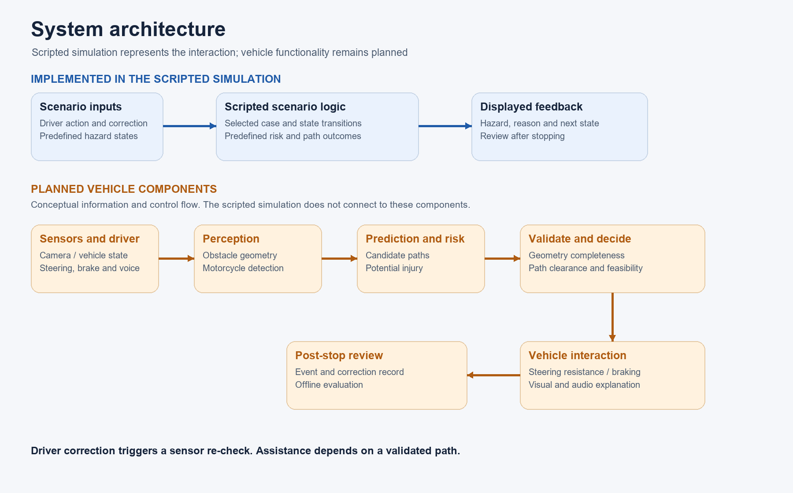
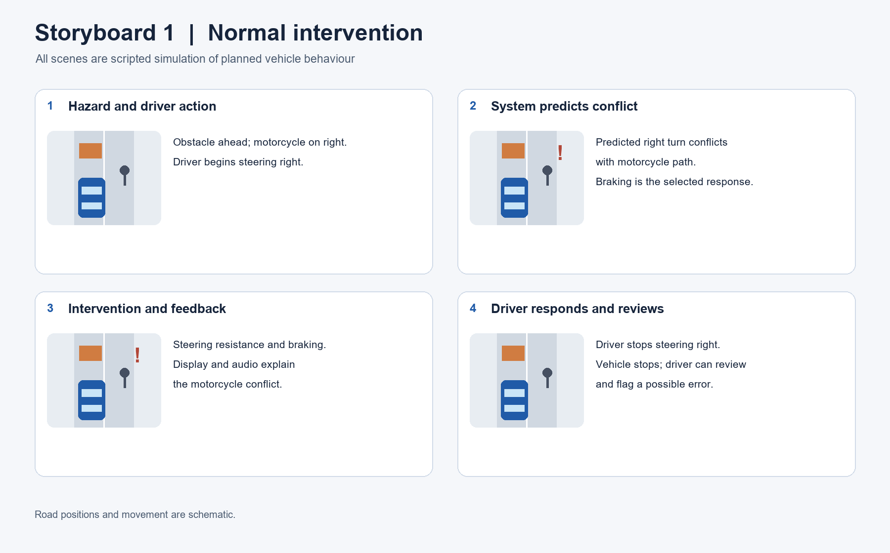
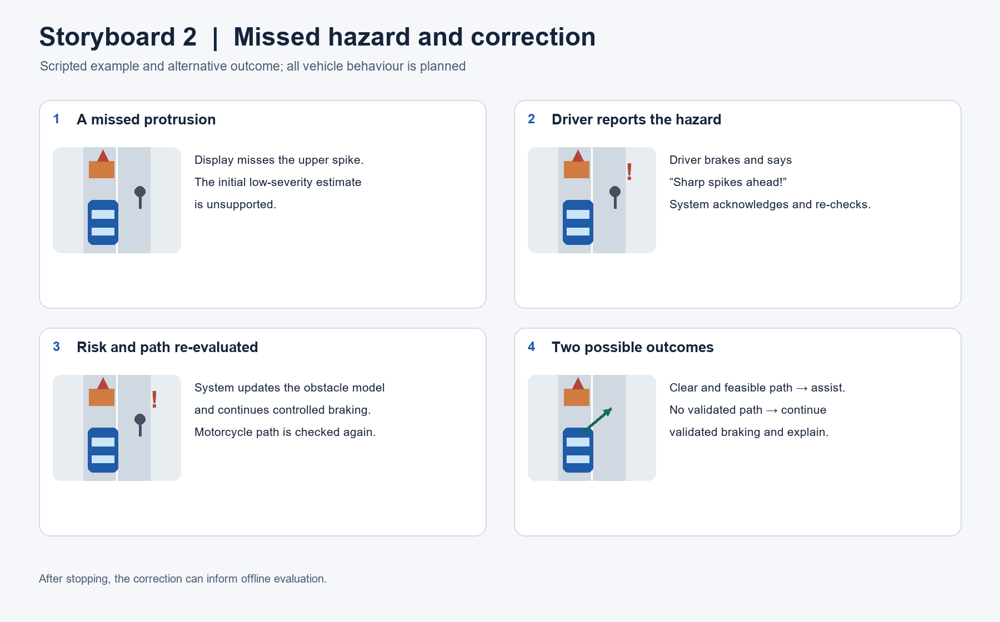

# Explaining and Correcting Steering Assistance in a Simulated Driving Scenario

**Counted words: 979 (abstract: 130; main text: 849).**

## Abstract

An assisted-driving system may resist a driver's steering to protect a motorcyclist while its own perception of an obstacle is incomplete. This project explores how an unfamiliar driver could understand such an intervention and report a missed hazard. Building on a literature review, interaction storyboards and a system-path exercise, I developed a scripted browser prototype showing a normal intervention and a missed-protrusion scenario. The driver can report the hazard and follow a simulated re-check, with different outcomes according to whether a right-side path is validated. The prototype represents explanations and decisions through predefined states. It does not sense a road, control a vehicle or establish the safety of a manoeuvre. Its contribution is a concrete interaction for examining feedback, correction and uncertainty, together with limitations and a plan for evaluation.

## Problem and project development

The driver wants to avoid an obstacle without harming a motorcyclist travelling on the right. In the initial Lab 2 scenario, the driver begins turning right. The system predicts a conflict with the motorcycle, resists steering and brakes. The failure storyboard changes one assumption: a sharp protrusion extends from the obstacle towards the cabin, but the system shows only its lower part. The driver's direct view contradicts the displayed assessment. An unfamiliar rental driver may also interpret steering resistance as a fault rather than assistance.

The design question is how to make the intervention intelligible and let the driver challenge an incomplete assessment while preserving the distinction between a correction and a verified safe manoeuvre. The human-centred perspective introduced in Week 1 frames the vehicle, driver and motorcyclist as a coupled interactive system. A technically plausible action alone does not explain what a person sees, understands or can do next.

My A1 review compared separate strands of evidence. Pechinger et al. (2021) showed that occlusion mattered in simulated cyclist encounters, motivating attention to incomplete perception. Mulder, Abbink and Boer (2012) found benefits of haptic steering support in curve negotiation, but that task does not establish how resistance is understood in this emergency. Koo et al. (2015) found that explanations of why a car acted helped performance compared with action descriptions alone, although the effects on feelings differed. Ha et al. (2020) found that explanation and perceived risk affected trust, while Taylor, Wang and Jeon (2023) studied explanation delivery and reliability in conditional automation. Together, these studies support clear reasons and attention to reliability, rather than treating more trust as the outcome. None validates this particular correction interface.

## Interaction and system design

The browser prototype translates the Lab 2 normal and failure storyboards into scripted steps. In the normal path, the display identifies the motorcycle as the reason for restricting the right turn and describes braking. In the failure path, the driver reports the protrusion, sees an acknowledgement and follows a re-check. A validated clear path leads to a simulated assisted manoeuvre. An unavailable path leads to continued braking and an explicit limitation. These are designed scenarios with predetermined conditions, not measurements of a real road.

*Figure 1. System architecture and implementation status.*

*Figure 2. Normal intervention.*

*Figure 3. Missed hazard and two scripted outcomes.*

| Design decision | Rationale and trade-off |
|---|---|
| Link steering restriction to the motorcycle and its predicted path. | Week 2 feedback and mental-model concepts suggest that resistance alone may be ambiguous. A brief reason can help an unfamiliar driver interpret it, although additional information competes for attention. |
| Show the driver's report and acknowledge the re-check. | The correction gives the person an action when the displayed perception is wrong. Acknowledgement makes the system's response visible, but the scripted prototype cannot assess speech recognition or the timing of a real intervention. |
| Keep correction and path validation separate. | The report is evidence of a possible missed hazard, not proof that turning is safe. The system must still consider the motorcyclist and manoeuvre feasibility. The fallback makes a remaining limitation visible. |
| Use concise in-motion feedback and a later review. | Week 2 attention and cognitive-load concepts motivate a short immediate message and more detail after stopping. The appropriate amount and timing require user testing. |

Week 3's conversation and model-boundary concepts informed the correction route. The driver communicates an observation, and the system acknowledges its meaning and next action. The prototype uses a scripted input, so it does not demonstrate a language model, speech processing or robust interpretation of varied wording. Lab 3 already distinguished a driver's report from sensor evidence and revised the system path to check obstacle completeness. Its standard and problem cases were structured simulations, not road tests.

Week 4's context and provenance concepts also shape the information flow. A future system would need to associate the driver's report with the current vehicle state, the previous obstacle assessment and fresh observations, while identifying their sources. It should expose the outcome of a check instead of letting a generated explanation stand in for validation. Here, the scenario state and branch outcomes are predefined. There is no retrieval system, external tool call or live sensor evidence.

## Evidence, limitations and next steps

The work developed from Lab 2's interaction loop and storyboards through Lab 3's standard and missed-protrusion cases. Lab 3's review identified two changes: explain the reason for resistance to an unfamiliar driver, and re-examine obstacle geometry after a correction. The prototype makes these proposed changes inspectable through a stepwise interaction. A browser walkthrough reached the normal review, the clear-path outcome and the unconfirmed-path fallback. These checks verify the scripted transitions, not their effectiveness with drivers.

The scenario assumes that there is time to communicate and reassess. It cannot establish whether a person would notice the warning, speak in time, understand uncertainty or make a better decision. Simulated path status cannot establish safe driving behaviour. Future work should first evaluate the interface in a controlled simulator with participants, comparing understanding and correction in both correct and mistaken interventions. Measures could include recognition of the hazard and intervention reason, correction attempts, workload and appropriate responses to unavailable paths. Only after that would a realistic sensing and control integration be a separate engineering question.

## Repository

Repository and README: publication pending. The local project includes the README and source files.

Submission commit or release: pending.

## References

Ha, T., Kim, S., Seo, D. and Lee, S. (2020) 'Effects of explanation types and perceived risk on trust in autonomous vehicles', *Transportation Research Part F: Traffic Psychology and Behaviour*, 73, pp. 271–280. https://doi.org/10.1016/j.trf.2020.06.021

Koo, J., Kwac, J., Ju, W., Steinert, M., Leifer, L. and Nass, C. (2015) 'Why did my car just do that? Explaining semi-autonomous driving actions to improve driver understanding, trust, and performance', *International Journal on Interactive Design and Manufacturing*, 9, pp. 269–275. https://doi.org/10.1007/s12008-014-0227-2

Mulder, M., Abbink, D.A. and Boer, E.R. (2012) 'Sharing control with haptics: Seamless driver support from manual to automatic control', *Human Factors*, 54(5), pp. 786–798. https://doi.org/10.1177/0018720812443984

Pechinger, M., Schroer, G., Bogenberger, K. and Markgraf, C. (2021) 'Cyclist Safety in Urban Automated Driving – Sub-Microscopic HIL Simulation', *2021 IEEE International Intelligent Transportation Systems Conference (ITSC)*, pp. 615–620. https://doi.org/10.1109/ITSC48978.2021.9565108

Taylor, S., Wang, M. and Jeon, M. (2023) 'Reliable and transparent in-vehicle agents lead to higher behavioral trust in conditionally automated driving systems', *Frontiers in Psychology*, 14, article 1121622. https://doi.org/10.3389/fpsyg.2023.1121622
